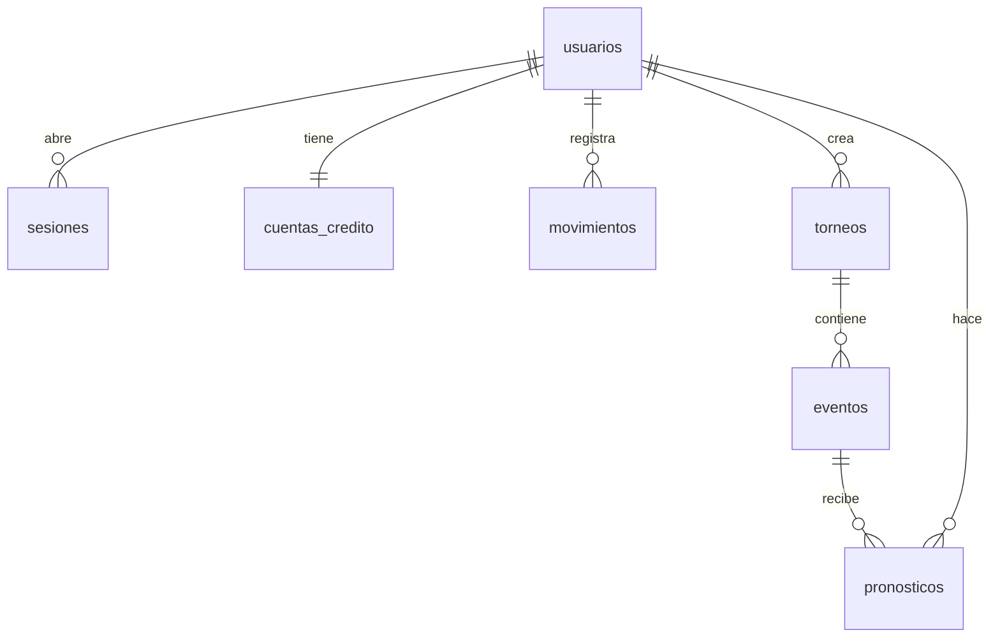

# TT-01 · Modelo de datos (Supabase / PostgreSQL)

Responsable: Julian · Script: `supabase/migrations/20261116000100_tt01_esquema.sql`

La versión de escritorio (Java) guarda en archivos de texto; la versión web usa este esquema en Supabase. Las reglas son las mismas en ambas.

| Tabla | Campos principales | Reglas en la base de datos |
|---|---|---|
| `usuarios` | identificacion (PK), nombre, rol, clave_hash, creado | Identificación de 5 a 15 alfanuméricos, única sin distinguir mayúsculas; rol PARTICIPANTE, ORGANIZADOR o AUDITOR; contraseña con bcrypt |
| `sesiones` | token (UUID), usuario_id, creada, expira | Caduca a las 8 horas |
| `torneos` | id, nombre, deporte, fecha_inicio, fecha_fin, creado_por | Nombre único; fin ≥ inicio |
| `eventos` | id, torneo_id, nombre, inicio, modalidad, opciones[], cierre, costo_creditos | 2 a 10 opciones; cierre ≤ inicio; costo > 0; sin duplicados (torneo, nombre, inicio) |
| `pronosticos` | id, usuario_id, evento_id, opcion, clave_solicitud, registrado, actualizado | Uno por usuario y evento; `clave_solicitud` única (HU-14) |
| `cuentas_credito` | usuario_id (PK), saldo, inicial_asignado | `saldo >= 0` (HU-11/HU-15); saldo inicial una sola vez (HU-07) |
| `movimientos` | id, operacion, usuario_id, tipo, cantidad, saldo_resultante, origen_tipo, origen_id, clave_idempotencia, justificacion, registrado_por, registrado | No se puede modificar ni borrar (HU-09); `clave_idempotencia` única |

## Relación entre saldo y movimientos

`cuentas_credito.saldo` es el saldo vigente y `movimientos` es el libro. Toda operación que cambia el saldo inserta un movimiento con el `saldo_resultante` en la misma transacción, por eso siempre se cumple:

```
saldo = suma(movimientos.cantidad) del usuario
```

HU-08 muestra las dos cifras y si coinciden; HU-25 (Sprint 3) usará la misma comparación para detectar inconsistencias.

## Seguridad

- RLS activo en todas las tablas y **sin políticas**: con la llave pública (anon) no se puede leer ni escribir ninguna tabla.
- El navegador solo llama funciones RPC `security definer`. Cada una valida el token de sesión y el rol antes de tocar los datos (HU-02, HU-26).


